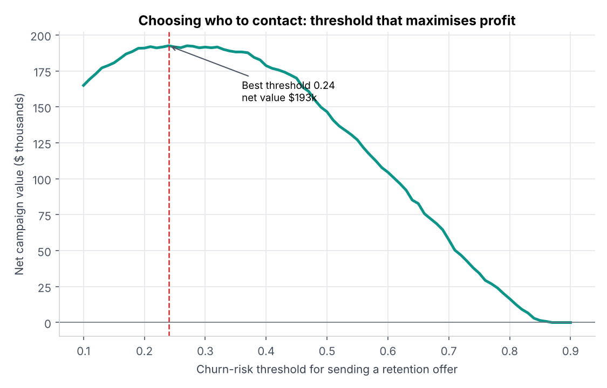
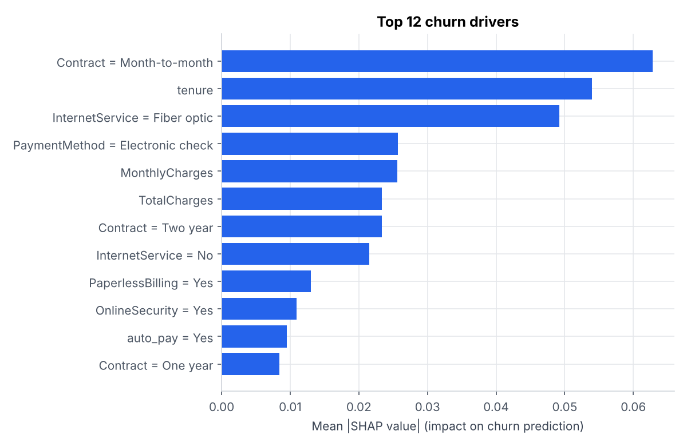
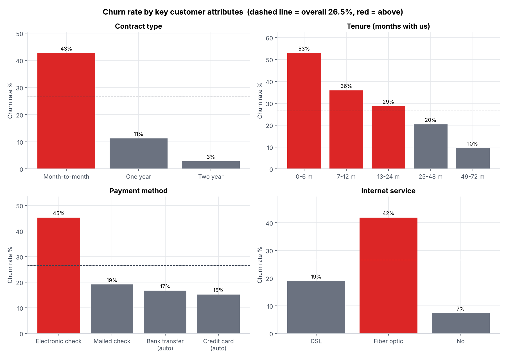
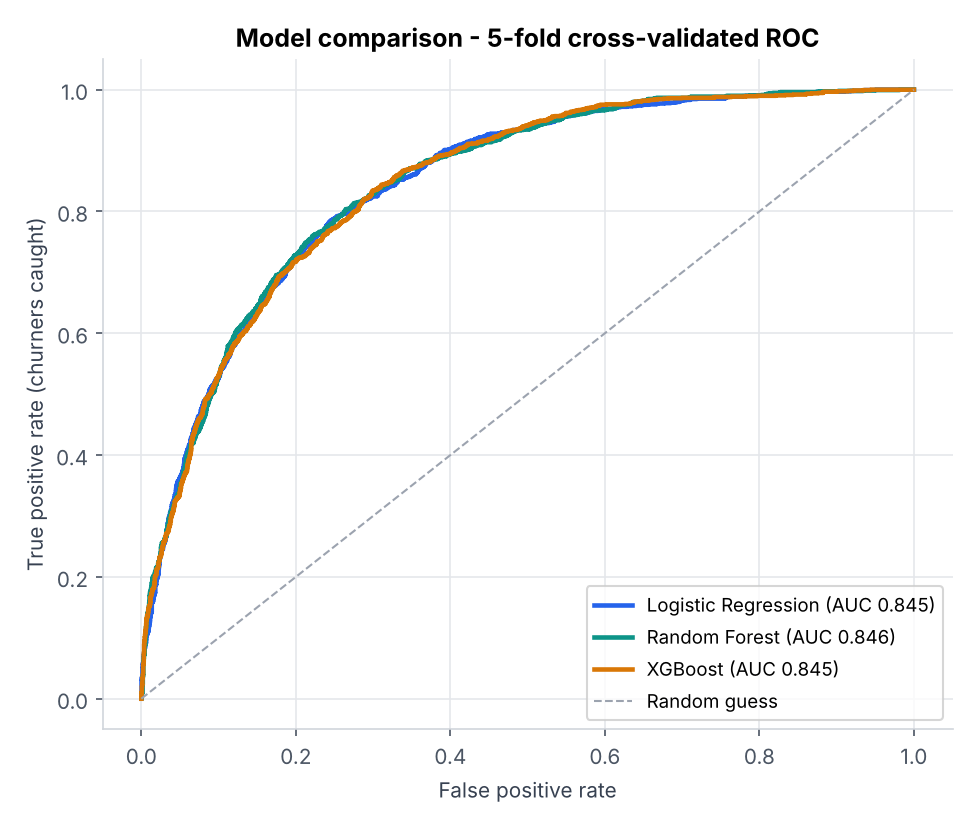
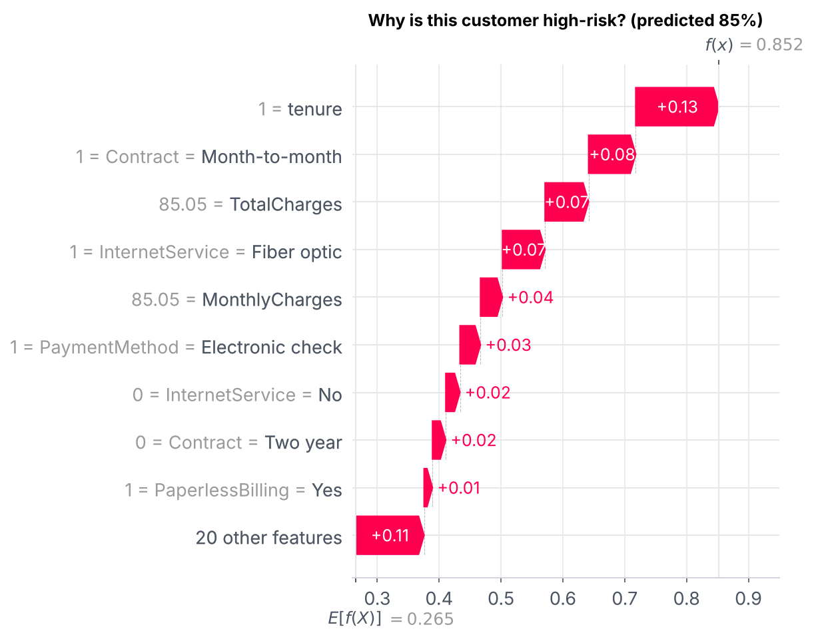
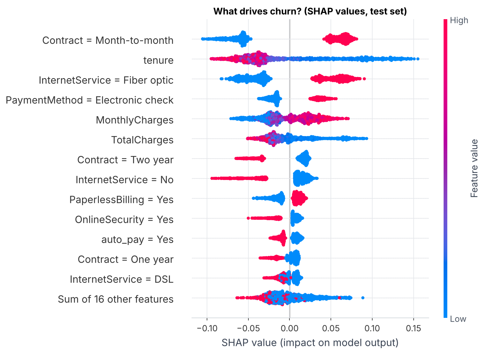

# 📉 Customer Churn Prediction & Retention Strategy


A telecom company loses **26.5% of its customers — 30% of its monthly revenue**. This project predicts who will
churn, explains **why** with explainable AI (SHAP), and turns the predictions into a **profit-optimised retention
campaign** with a ranked, ready-to-use list of customers to call and what to offer each one.

---

## 🏆 Results

| | |
|---|---|
| **Best model** | Random Forest (compared against Logistic Regression and XGBoost) |
| **ROC-AUC on unseen test set** | **0.85** |
| **Churners caught** | **83%** of churners flagged at the profit-optimal threshold |
| **Campaign value (test set)** | **$45.5k net** from AI-targeted offers vs **$13.4k** for contacting everyone → **3.4× better** |
| **Retention list** | 1,588 active customers flagged for an offer (485 high, 1,103 medium risk) |

<p align="center"> </p>

## 💡 Key insights

1. **Month-to-month contracts are the #1 driver.** 43% churn vs 3% on two-year contracts — and they account for **87% of revenue lost**.
2. **The first 6 months are critical.** New customers churn at **53%**; after 4 years it drops to 10%.
3. **Fiber customers without Tech Support churn at 49%**, vs 23% for those who have it.
4. **Electronic-check payers churn at 45%**, about 3× customers on automatic card/bank payments.
5. **Every extra add-on service makes customers stickier** — from 52% churn with no add-ons to 5% with all six.
6. **Riskiest segment:** new, month-to-month, fiber customers — **70% churn**, ~$640k annual revenue lost.

<p align="center"></p>

## ✅ Recommendations

| # | Action | Who | Why |
|---|---|---|---|
| 1 | Offer a 1-year contract with a 10–15% discount | High-risk month-to-month customers | M2M = 87% of lost revenue |
| 2 | Onboarding call + welcome discount | Customers in their first 6 months | 53% churn rate |
| 3 | 3 months of free Tech Support | Fiber customers without support | 49% → 23% churn |
| 4 | One-time credit to switch to auto-pay | Electronic-check payers | 45% vs ~15% churn |
| 5 | **Target with the model, not blanket offers** | Risk ≥ profit threshold | 3.4× the net value |

---

## 🛠️ Approach

```
customer-churn-prediction/
├── data/
│   ├── raw/telco_customer_churn.csv     # IBM Telco dataset, 7,043 customers
│   └── processed/churn_clean.csv
├── sql/churn_queries.sql                # 8 queries: CTEs, window functions, CASE, HAVING
├── src/
│   ├── clean.py                         # cleaning, validation, feature engineering
│   ├── sql_analysis.py                  # loads SQLite and runs the queries
│   ├── eda.py                           # exploratory charts
│   ├── features.py                      # shared preprocessing pipeline
│   ├── train.py                         # model comparison, profit threshold, SHAP, scoring
│   ├── retention.py                     # next-best-action rules
│   └── predict.py                       # score + explain one customer
├── notebooks/analysis.ipynb             # the full story with outputs, start here
├── reports/
│   ├── at_risk_customers.csv            # every active customer, risk score + action
│   ├── data_quality_report.md
│   ├── sql_results.md
│   ├── metrics.json
│   └── figures/
├── models/churn_model.joblib
├── app.py                               # Streamlit app
└── run_pipeline.py                      # runs everything end to end
```

### 1 · Data cleaning & feature engineering
- `TotalCharges` was stored as **text** because of 11 blank values. All 11 have `tenure = 0` (new, not yet billed), so they're set to **0** rather than imputed with a mean that would be wrong.
- Collapsed 9,838 redundant `"No internet service"` / `"No phone service"` values into `"No"`.
- Validation checks (value ranges, no nulls, billing consistency) — see [`reports/data_quality_report.md`](reports/data_quality_report.md).
- Engineered features: tenure groups, number of add-on services, auto-pay flag, family flag, **price-increase signal** (current vs historical average bill).

### 2 · SQL analysis — [`sql/churn_queries.sql`](sql/churn_queries.sql)
KPI snapshot and lost MRR, contract / tenure-cohort / payment analysis, add-on stickiness, demographic splits, and a
**CTE + `RANK()` query that combines the top 3 drivers** to find the riskiest segments. Output in [`reports/sql_results.md`](reports/sql_results.md).

### 3 · Modelling
- Stratified 80/20 split; **5-fold cross-validation** to compare Logistic Regression, Random Forest and XGBoost (all ~0.85 AUC — the data's signal is in a few strong features, so a simple, robust model is enough).
- **No class re-weighting** so probabilities stay realistic; the 26/74 imbalance is handled through the threshold.
- **Profit-based threshold:** instead of the default 0.5, the cut-off is chosen to maximise campaign value (offer cost $60, 30% save rate, 12 months revenue retained — all editable in `src/train.py`). Chosen on cross-validated predictions, confirmed once on the test set.

<p align="center"> </p>

### 4 · Explainable AI with SHAP
SHAP shows *why* the model predicts churn — both overall (beeswarm / importance) and for **each individual customer**,
so a retention agent knows what to talk about on the call.

<p align="center"></p>

### 5 · From prediction to action
Every active customer gets a **churn probability, risk band, revenue at risk and a recommended action**
([`reports/at_risk_customers.csv`](reports/at_risk_customers.csv)), ready to hand to a retention team or load into Power BI / Excel.

### 6 · Streamlit app
- **Predict a customer** — what-if simulator: change contract, tenure, payment method or add-ons and watch risk and SHAP reasons update live
- **Churn dashboard** — KPIs and churn drivers with filters
- **Retention list** — all active customers by risk band, with recommended actions, downloadable as CSV

```bash
python src/predict.py
```
```json
{ "churn_probability": 0.73, "risk_band": "High", "annual_revenue_at_risk": 779.66,
  "recommended_action": "Onboarding call + first-3-months welcome discount",
  "top_reasons": [ {"feature": "tenure = 2", "direction": "raises risk"},
                   {"feature": "Contract = Month-to-month", "direction": "raises risk"},
                   {"feature": "InternetService = Fiber optic", "direction": "raises risk"} ] }
```

---

## ▶️ Run it yourself

```bash
git clone https://github.com/saziaparween89/customer-churn-prediction.git
cd customer-churn-prediction
pip install -r requirements.txt

python run_pipeline.py      # cleaning -> SQL -> EDA -> models -> retention list (~1 minute)
streamlit run app.py        # open http://localhost:8501
```

## ⚠️ Limitations & next steps
- Single snapshot without dates → can't model *when* a customer will leave (next: survival analysis).
- Offer cost and save rate are assumptions → validate with an A/B test before rollout.
- SHAP shows associations, not causes → test interventions (e.g. free tech support) experimentally.

**Data:** [IBM Telco Customer Churn](https://github.com/IBM/telco-customer-churn-on-icp4d) sample dataset.

---
**Sazia Parween** · Data Analyst · [Portfolio](https://saziaparween89.github.io) · [GitHub](https://github.com/saziaparween89) · saziaparween89@gmail.com
